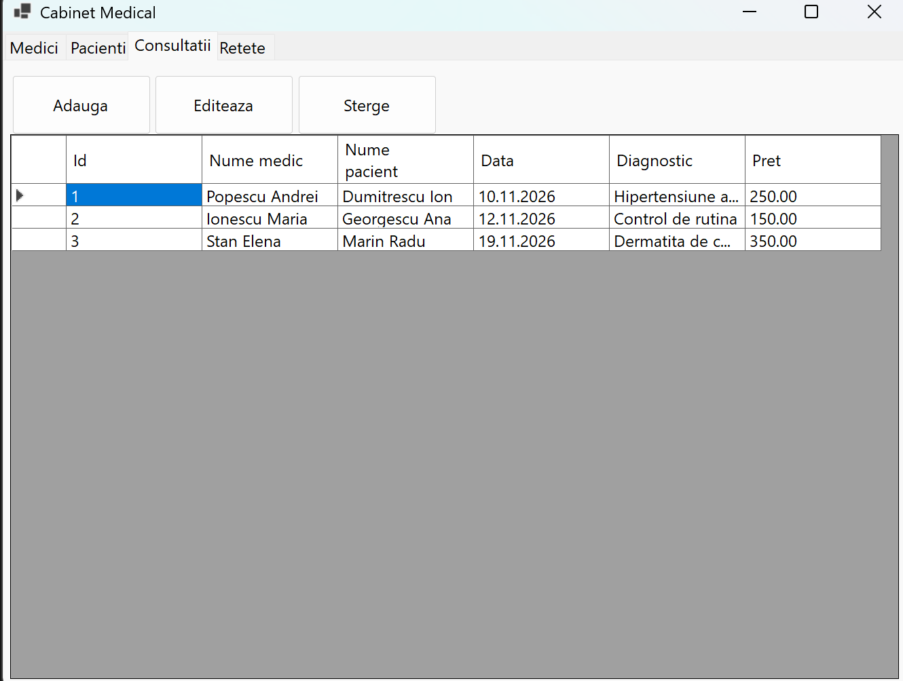

# CabinetMedical-WinForms

A Windows Forms desktop application for managing the daily activity of a medical clinic: doctors, patients, consultations and prescriptions.

The project started as an assignment for the Windows Applications Programming course at the Bucharest University of Economic Studies (ASE, CSIE) and was later refactored and migrated to .NET 8. It covers the full flow of a data-driven desktop application: a layered structure, a local SQLite database created on first run, CRUD operations and input validation.



## Key Functionality

- Manage four related entities from a single tabbed window:
  - **doctors** – name, specialty and phone
  - **patients** – name, CNP, phone and date of birth
  - **consultations** – doctor, patient, date, diagnosis and price
  - **prescriptions** – doctor, patient, medication and issue date
- Add and edit records through dedicated dialog forms
- Select the doctor and patient from drop-down lists instead of typing IDs
- Display doctor and patient names in the consultations and prescriptions tables
- Confirm every deletion before it is applied
- Show a clear message instead of crashing when an unexpected error occurs

## Built With

- C# and .NET 8
- Windows Forms: `TabControl`, `DataGridView`, `ComboBox` data binding, modal dialogs
- SQLite through `Microsoft.Data.Sqlite` (ADO.NET)
- GitHub Actions for automatic builds on Windows

## Repository Layout

```
.
├── CabinetMedical.slnx            # Visual Studio solution
├── CabinetMedical/
│   ├── CabinetMedical.csproj      # Project file (.NET 8, Windows Forms)
│   ├── Program.cs                 # Entry point: creates the database and starts the app
│   ├── Modele/                    # Data classes: Medic, Pacient, Consultatie, Reteta
│   ├── AccesBD/                   # Database connection and one repository per table
│   └── Formulare/                 # Main window and add/edit dialogs
├── docs/
│   └── fereastra-principala.png   # Screenshot of the main window
└── README.md
```

The forms never contain SQL. They call the repositories in `AccesBD/`, which return objects from `Modele/`.

## Database Schema

The database file `cabinet.db` is created automatically next to the executable on first launch and is not tracked by Git.

| Table | Contents |
|---|---|
| `Medici` | Doctors, with specialty and phone |
| `Pacienti` | Patients, with CNP, phone and date of birth |
| `Consultatii` | Consultations, each linked to a doctor and a patient, with diagnosis and price |
| `Retete` | Prescriptions, each linked to a doctor and a patient, with medication and issue date |

## Getting Started

Requirements: Windows and Visual Studio 2022 with the **.NET desktop development** workload (or the .NET 8 SDK).

1. Clone the repository:
   ```
   git clone https://github.com/alexiacristea/CabinetMedical-WinForms.git
   ```
2. Open `CabinetMedical.slnx` in Visual Studio.
3. Press **F5**. NuGet packages are restored automatically.

Alternatively, from the command line:

```
dotnet run --project CabinetMedical
```

The user interface is in Romanian.

## Data Integrity Rules

- Every table has a primary key, and consultations and prescriptions reference doctors and patients through foreign keys
- Foreign keys are enforced (`Foreign Keys=True`), since SQLite ignores them by default
- A doctor or patient who still has consultations or prescriptions cannot be deleted; the user is told why
- Names, specialty, medication and diagnosis are mandatory; the price must be a valid number
- All queries are parameterized, so user input is never concatenated into SQL
- Dates are stored as `yyyy-MM-dd` and read independently of the system's regional settings

## Improvements Over the Original Coursework

The project was refactored after the original submission to:

- fix the solution and project files, which referenced an absolute local path and a deleted form, so the project opens and builds on any machine
- migrate from .NET Framework 4.8 to .NET 8 with an SDK-style project file
- remove unused Entity Framework packages and stop committing NuGet packages to the repository
- enforce foreign keys, so deleting a doctor or patient no longer leaves hidden orphan records
- dispose of data readers and commands correctly
- store the database next to the executable instead of the current working directory
- add a global error handler and format dates and prices in the tables
- add an automatic build on Windows with GitHub Actions

## Skills Demonstrated

- Building a multi-form desktop application with Windows Forms
- Separating the user interface, data access and data model into distinct layers
- Applying the repository pattern for CRUD operations
- Working with a relational database through ADO.NET and parameterized queries
- Binding collections to `DataGridView` and `ComboBox` controls
- Validating user input and handling database errors
- Modernizing a legacy .NET Framework project
